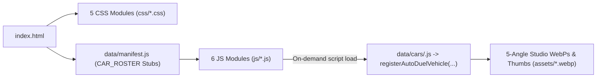

# AUTODUEL — Head-to-Head Car Comparison

**[Launch Live Demo](https://devdinges.github.io/AutoDuel/)**

An interactive head-to-head vehicle comparison and used-car ownership web application built with zero-build vanilla HTML, CSS, and JavaScript.

---

## Core Features (Release 1.0)

- **Showroom Contender Grid:** Instant search across make, model, engine code, gearbox type (`Automatic` / `Manual` / `DSG` / `e-CVT`), HP/price/year ranges, and powertrain attributes, paired with body-type filter pills, sort modes, lineup-average (`Ø`) index badges, and quick `C1`/`C2` lock-in or single-car `Inspect`.
- **3-Column Fused Compare Arena:** Side-by-side contender viewports (`Car 1` | `Fused Center Console` | `Car 2`) with dedicated Engine and `Manual` / `Automatic` Gearbox selectors covering `5` pillars, `19` sub-ratings, and `40` technical spec rows — including same-model engine duels.
- **Priority Equalizer & Weighted Pillars (`0.25×`–`2.0×`):** Intra-pillar weights reflect real ownership stakes (e.g., Engine `45%` & Gearbox `25%` inside Reliability; Maintenance/Repair `35%` & Fuel `30%` inside Running Costs), while interactive pillar sliders dynamically recalculate the exact `1×` weighted 5-pillar average (`0.0–10.0`) and `F` to `S+` index classes.
- **Single-Car Vehicle Stage:** 5-angle interactive turntable (`Front`, `Front-Side`, `Side`, `Side-Rear`, `Rear`), `5–12` OEM factory paint slider, Engine & Gearbox selectors (`121` engines / `192` engine-gearbox pairings), and a **7-Tab In-Depth Ownership Dossier** (`Overview & Verdict`, `5-Pillar Rating`, `Technical Specs`, `Trims & Interior`, `Reliability & Issues`, `Running Costs`, `Market & Pricing`).
- **Engineering Dossiers & Market Curves (`€`):** 4-way keyboard-navigable datasheets (`↑`/`↓` across 19 sub-ratings, `←`/`→` switching `C1`/`C2`), `Before You Buy` checklists, `0–250,000 km` service roadmaps, `routine`/`critical` repair guides, Buyer Fit cards, and interactive MSRP-to-used depreciation curves.
- **Trilingual & Dual Studio Themes:** Seamless switching across **English (`EN`)**, **German (`DE`)**, and **Russian (`RU`)**, styled in `Dark` and `Light` themes with fluid `clamp(...)` viewport scaling.

---

## Architecture & Lazy Data Hydration

AutoDuel runs as a **zero-build static bundle** with strict separation between application logic and vehicle data:

- **Modular Runtime:** `index.html` loads `css/*.css` (`tokens-base.css`, `home-catalog.css`, `duel-arena.css`, `modals-popovers.css`, `vehicle-indepth.css`), auto-generated catalog stubs (`data/manifest.js`), and ordered `js/*.js` modules (`i18n-schema.js`, `state-and-scoring.js`, `home-catalog.js`, `duel-arena.js`, `vehicle-indepth.js`, `app.js`).
- **On-Demand Vehicle Hydration:** Full per-car specs, OEM paints, and 7-tab `inDepth` dossiers live in self-contained `data/cars/<id>.js` files and hydrate lazily when a vehicle is selected or inspected.
- **DRY Schema & Asset Factory:**
  - `data/cars/_template.js` + `.agents/skills/add-car/SKILL.md` standardize vehicle authoring around shared `SPEC_TOKENS`, `SPEC_DOSSIER_PRESETS`, `DOSSIER_TECH_LABELS`, and `SHARED_BUYER_FIT_CARDS`.
  - `scripts/process-assets.ps1` converts studio renders into `1376×768` WebP angle sets and `600px` WebP thumbnails (`RIFF/WEBP`).
  - `scripts/build-manifest.ps1` deterministically regenerates `data/manifest.js` (`SHA-256` content hash) and supports `-NextSlot` & `-Check`.
  - `validate.ps1` + `.github/workflows/validate.yml` enforce delimiter balance, Node `--check` JS syntax, load order, zero symbol collisions, full v2 car/engine schema (`40` specs, `19` sub-stats, `@tokens`, `BuyerFit`), valid WebP headers, manifest parity, and translation hygiene on every push and PR.

---

## Working with AI Agents (`AGENTS.md` & `GEMINI.md`)

- **[`AGENTS.md`](./AGENTS.md) — Project Invariants & Schema:** Locks down the zero-build static architecture, `C1`/`C2` labels, `Dark`/`Light` CSS-token themes, `EN`/`DE`/`RU` translation rules, DRY dossier/buyer-fit schema, `19` required `subStats`, and `5`-angle WebP + thumbnail layout.
- **[`GEMINI.md`](./GEMINI.md) — Execution Protocol & Tooling:** Enforces a structured Pre-Execution Gate before multi-file edits, DRY shared-base / delta-override authoring, `/add-car` onboarding, and full verification via `./validate.ps1`.

---

## Included Vehicle Roster (15 Models • 121 Engines • 75 Studio WebPs + 15 Thumbs)

| # | Model | Body Type | Powertrains Covered |
| :--- | :--- | :--- | :--- |
| **01** | **2012–2019 Toyota Auris (E180)** | Hatchback | `1.33 Dual VVT-i`, `1.2 Turbo`, `1.6 Valvematic`, `1.8 Hybrid`, `1.4 / 1.6 / 2.0 D-4D` |
| **02** | **2011–2017 Honda Civic (FK)** | Hatchback | `1.4 i-VTEC`, `1.8 i-VTEC`, `1.6 i-DTEC`, `2.2 i-DTEC` |
| **03** | **2006–2012 Honda CR-V (RE)** | SUV | `2.0 i-VTEC`, `2.4 i-VTEC`, `2.2 i-CTDI`, `2.2 i-DTEC` |
| **04** | **2015–2020 Peugeot 308 GTi (T9)** | Hot-Hatch | `1.6 THP GTi (263 HP)` |
| **05** | **2007–2014 Ford Mondeo (BA7)** | Sedan | `1.6 / 2.0 / 2.3 Duratec`, `1.6 / 2.0 EcoBoost`, `2.5T`, `1.6 / 1.8 / 2.0 / 2.2 TDCi` |
| **06** | **2015–2017 Honda Civic Type R (FK2)** | Hot-Hatch | `2.0 VTEC Turbo (310 HP)` |
| **07** | **2008–2015 Honda Accord (CU)** | Sedan | `2.0 i-VTEC`, `2.4 i-VTEC`, `2.2 i-DTEC` |
| **08** | **2008–2015 Honda Jazz (GE)** | Subcompact | `1.2 i-VTEC`, `1.3 i-VTEC`, `1.3 IMA Hybrid` |
| **09** | **2007–2015 Mercedes-Benz C-Class (W204)** | Sedan | `C 180–350 Kompressor/CGI/V6`, `C 180–350 CDI` |
| **10** | **2006–2013 Toyota RAV4 (XA30)** | SUV | `2.0 VVT-i`, `2.0 Valvematic`, `2.2 D-4D`, `2.2 D-CAT` |
| **11** | **2010–2015 Kia Sportage (SL)** | SUV | `1.6 GDI`, `2.0 CVVT`, `2.0 GDI`, `1.7 CRDi`, `2.0 CRDi (136/184 HP)` |
| **12** | **2008–2012 Mazda 6 (GH)** | Sedan | `1.8 / 2.0 / 2.5 MZR`, `2.0 MZR-DISI`, `2.0 / 2.2 MZR-CD` |
| **13** | **2008–2018 Toyota Avensis (T27)** | Sedan | `1.6 / 1.8 / 2.0 Valvematic`, `1.6 / 2.0 / 2.2 D-4D`, `2.2 D-CAT` |
| **14** | **2003–2013 Audi A3 Sportback (8P)** | Hatchback | `1.2–2.0 TFSI / FSI`, `1.6 / 1.9 / 2.0 TDI (PD & CR)` |
| **15** | **2012–2020 Audi A3 Sportback (8V)** | Hatchback | `1.0–2.0 TFSI`, `g-tron`, `e-tron PHEV`, `1.6 / 2.0 TDI` |

---

## Running & Validating Locally

No build step or package manager required — open `index.html` directly in any modern browser or serve the folder with any static HTTP server.

---

## Changelog

* **v7 — Release 1.0 (26.11.2026):** Modular zero-build CSS/JS split, per-car lazy hydration + manifest pipeline, complete 15-car / 121-engine / 192-gearbox-pairing 7-tab Vehicle Stage, dedicated Manual/Automatic gearbox selector, trim 10-tier palette + sticky comparison matrix, expanded OEM paint slider, WebP studio asset pipeline, pure 1× weighted scoring, and hardened `/add-car` + GitHub Actions CI validation.
* **v0.7 (25.11.2026):** Pre-release to V1.0: 7-Tab In-Depth Look, trims and equipment matrix, yearly cost calculation with updated value curve 
* **v0.6 (22.11.2026):** Integration of design-overhaul branch: Single-car Vehicle Stage, Additions to Showroom, Value Graph
* **v0.5 (19.11.2026):** Major Overhaul of the Duel-Site, merging of stat-boxes, info-dossier 2.0 
* **v0.4 (17.11.2026):** New Homepage, animated background marquee, various new animations, 'Buyer Fit' for quick personalized guidance, extended "i"-dossier for all categories 
* **v0.3 (15.11.2026):** Interactive Priority Equalizer sliders, high-mileage repair roadmaps (`0–250,000 km`), `Before You Buy` checklists, and expanded vehicle roster.
* **v0.2 (14.11.2026):** Comprehensive homepage redesign, Smash-style contender selection grid, and additional models.
* **v0.1 (13.11.2026):** Initial release and GitHub Pages deployment.
